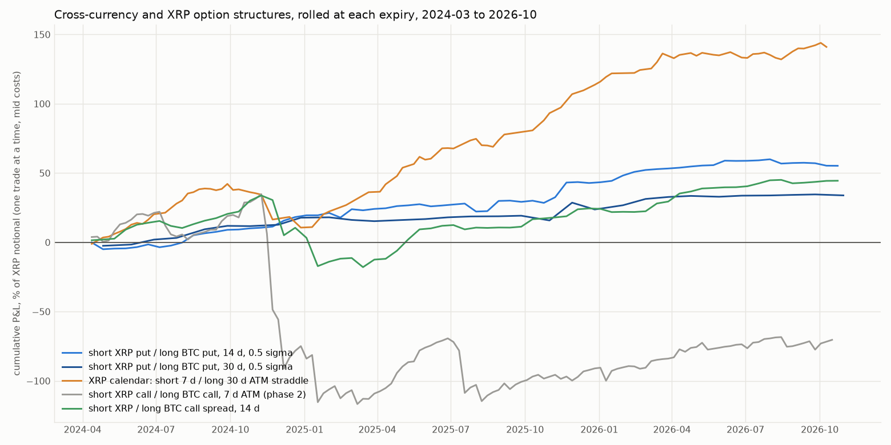

# Phases 3–4: other cross-currency verticals, diagonals and calendars

- **Code:** `scripts/other_structures.py run | report`, `scripts/robustness.py`.
- **Outputs:** `reports/phase3/` (`summary.csv`, `robustness.csv`, `cumulative_pnl.png`).
- **Method:** the same engine, entries, strike rule, costs and drift split as phase 2. XRP is the short-premium
  side (1 USD of XRP notional), BTC the long side.
- **BTC sizing:**
  - **beta-delta** for directional structures: BTC dollar delta = −beta × XRP dollar delta;
  - **beta²-gamma** for delta-neutral ones: BTC cash gamma = beta² × XRP cash gamma. Through the common factor, a
    short XRP straddle loses beta² × (BTC move)², which the long BTC straddle offsets;
  - **vega** as an alternative.

## Structures

| Name | XRP side (short premium) | BTC side (long) | Sizing |
|---|---|---|---|
| put | short put, m = 0.5 or 1 below | long put, same m | beta-delta |
| straddle | short ATM straddle | long ATM straddle | beta²-gamma, vega |
| strangle | short ±1σ strangle | long ±1σ strangle | beta²-gamma |
| callspr | short call spread (ATM / +1σ) | long call spread (ATM / +1σ) | beta-delta |
| rr | short 25d risk reversal (sell call, buy put) | long 25d risk reversal | beta-delta |
| dcall (diagonal) | short front call (7 or 14 d) | long back call (30 or 60 d) | beta-delta |
| dstraddle (diagonal) | short front ATM straddle | long back ATM straddle | beta²-gamma, vega |
| cal_xrp / cal_btc (calendar) | short front ATM straddle, long back ATM straddle, same asset, equal units | – | – |
| xcal (cross calendar) | XRP calendar | BTC reverse calendar (long front, short back) | beta²-gamma on the fronts |

Diagonals and calendars are held to the front expiry; the back legs are closed at that day's 09:00 quotes.

## Results: verticals

Mean P&L per trade, % of XRP notional, **pessimistic costs** (mid in brackets where it changes the sign or the
picture). "t" = mean / std × √(independent trades).

| Structure | 7 d | 14 d | 30 d | Worst trade (30 d) |
|---|---|---|---|---|
| **put, m = 0.5** | **+0.30** (t 1.1) | **+0.56** (t 1.7) | **+1.34** (t 2.0) | −10 |
| **put, m = 1** | +0.11 (t 0.5) | **+0.39** (t 1.8) | **+0.83** (t 2.2) | −8 |
| straddle, beta²-gamma | −0.39 | −0.88 | −5.50 | −205 |
| straddle, vega | −0.47 | −0.87 | −5.07 | −209 |
| strangle, ±1σ | −0.98 | −1.64 | −6.98 | −191 |
| call spread | −0.08 (mid +0.05) | +0.09 (mid +0.26) | +0.48 (mid +0.80) | −50 |
| risk reversal (skew trade) | −1.78 | −2.97 | −9.45 | −188 |

## Results: diagonals and calendars

| Structure | Front / back | Trades | Mean, mid | Mean, pessimistic | Worst (pess.) |
|---|---|---|---|---|---|
| dcall ATM | 7 / 30 d | 758 | −0.57 | −0.71 | −94 |
| dcall +1σ | 7 / 30 d | 729 | −1.16 | −1.17 | −88 |
| dstraddle, beta²-gamma | 7 / 30 d | 756 | −0.53 | −0.81 | −92 |
| dstraddle, vega | 7 / 30 d | 756 | −0.03 | −0.29 | −93 |
| dstraddle, vega | 7 / 60 d | 776 | −0.06 | −0.32 | −93 |
| dcall / dstraddle | 14 / 60 d | ~900 | −0.5 to −2.3 | −0.9 to −2.3 | −131 |
| **XRP calendar** | 7 / 30 d | 449 | **+1.44** (t 3.8) | +0.36 (t 0.8) | −44 |
| **XRP calendar** | 7 / 60 d | 361 | **+1.68** (t 3.4) | +0.35 (t 0.6) | −44 |
| **XRP calendar** | 14 / 60 d | 348 | **+2.48** (t 1.7) | +0.62 (t 0.6) | −60 |
| BTC calendar | 7 / 30 d | 766 | −0.56 | −0.55 | −13 |
| BTC calendar | 14 / 60 d | 910 | −0.80 | −0.83 | −9 |
| cross calendar | 7 / 30 d | 449 | +0.63 | −0.41 | −44 |
| cross calendar | 14 / 60 d | 348 | +1.59 | −0.24 | −61 |

XRP calendars have fewer trades because they need a two-sided XRP back-month quote at entry and at exit.

## Robustness of the winners

| Structure | Costs | All | Without Q4-2024 | Mar 2024–Jun 2025 | Jul 2025–Oct 2026 | Drift-adjusted | 2024 / 2025 / 2026 |
|---|---|---|---|---|---|---|---|
| put 14 d, m = 0.5 | pess | +0.56 (t 1.7) | +0.47 (t 1.3) | +0.72 (t 1.3) | +0.41 (t 1.0) | +0.27 | +0.94 / +0.55 / +0.21 |
| put 14 d, m = 1 | pess | +0.39 (t 1.8) | +0.38 (t 1.6) | +0.35 (t 1.1) | +0.44 (t 1.4) | +0.26 | +0.35 / +0.38 / +0.45 |
| put 30 d, m = 0.5 | pess | +1.34 (t 2.0) | +1.31 (t 1.8) | +1.56 (t 1.9) | +1.14 (t 1.1) | +0.71 | +1.56 / +1.67 / +0.74 |
| put 30 d, m = 1 | pess | +0.83 (t 2.2) | +0.85 (t 2.0) | +0.83 (t 2.2) | +0.82 (t 1.2) | +0.63 | +0.81 / +0.97 / +0.66 |
| call spread 30 d | pess | +0.48 (t 0.3) | +2.07 (t 1.5) | −0.06 | +1.01 (t 1.3) | +4.4 | −2.95 / +2.32 / +1.26 |
| XRP calendar 7/30 | mid | +1.44 (t 3.8) | +1.61 (t 4.4) | +1.47 (t 2.6) | +1.40 (t 2.9) | +1.41 | +0.59 / +2.66 / +0.95 |
| XRP calendar 7/30 | pess | +0.36 (t 0.8) | +0.69 (t 1.9) | −0.03 | +0.81 (t 1.6) | +0.25 | −1.04 / +1.46 / +0.58 |

**What the BTC leg adds** (pessimistic costs, % of XRP notional per trade):

| Structure | Hedged: mean / std / 5th pct / worst | XRP leg alone: mean / std / 5th pct / worst | Variance removed | BTC leg's own P&L |
|---|---|---|---|---|
| put 7 d, m = 0.5 | +0.30 / 2.6 / −3.6 / −15 | +0.34 / 4.2 / −9.7 / −25 | 61 % | −0.04 |
| put 14 d, m = 0.5 | +0.56 / 3.0 / −4.0 / −15 | +0.65 / 4.6 / −9.2 / −26 | 58 % | −0.08 |
| put 14 d, m = 1 | +0.39 / 1.9 / −0.8 / −11 | +0.38 / 3.1 / −5.7 / −23 | 62 % | +0.01 |
| put 30 d, m = 0.5 | +1.34 / 3.4 / −3.5 / −10 | +1.52 / 5.4 / −12.9 / −19 | 60 % | −0.17 |
| put 30 d, m = 1 | +0.83 / 1.9 / −0.4 / −8 | +1.02 / 2.9 / −7.5 / −16 | 59 % | −0.19 |
| call spread 14 d | +0.09 / 4.8 / −7.3 / −28 | +0.46 / 5.5 / −10.1 / −29 | 25 % | −0.37 |
| straddle 7 d | −0.39 / 9.8 / −14.6 / −93 | −0.05 / 10.9 / −19.3 / −95 | 20 % | −0.34 |

The worst put trades were entered in late January 2025 (7–14 d) and around 30 September 2024 and 6 January 2026
(30 d): periods when XRP fell further than its beta to BTC implied.

## Findings

1. **The cross-currency hedge works on the downside and fails on the upside.** XRP and BTC fall together but XRP
   rallies alone. A long BTC put removes about 60 % of the variance of a short XRP put, almost for free (the BTC
   puts lose only 0–0.2 % per trade). A long BTC call removes only 20–30 % of a short XRP call's variance.
2. **The one feasible cross structure is short XRP put / long BTC put** (beta-delta sized).
   - +0.4–1.3 % of XRP notional per 14–30 day trade at pessimistic costs, about +9–17 %/yr of notional.
   - Positive in every year, in both halves of the sample, and without Q4 2024.
   - Small drawdowns: 5th percentile −0.4 to −4 %, worst trade −8 to −15 %.
   - Evidence is moderate (t ≈ 1.7–2.2) among about 100 configurations tested, so a part of it may be luck.
   - The return comes from the XRP put premium, which optXRP also found. The BTC leg contributes risk reduction,
     not return. Between a quarter and a half of the mean is XRP's outperformance of BTC (the drift part).
3. **The thesis as stated, selling XRP's higher premium against BTC's, does not work for delta-neutral vol
   structures.** Hedged straddles, strangles and vega-matched diagonals all lose. XRP's higher short-tenor premium
   is paid for by its idiosyncratic jumps, which the BTC leg cannot hedge.
4. **The skew trade loses badly.** Selling XRP's rich call skew against BTC's put skew (risk reversals) lost at
   every tenor: XRP's calls were rich for a reason.
5. **Call spreads cap the damage but earn little.** The short XRP call spread breaks even overall at pessimistic
   costs. It is positive outside Q4 2024 (+0.6–2 % per trade) but that is mostly XRP's drift.
6. **Calendars: XRP's term structure is the clearest premium, but it is not tradable at the touch.**
   - Selling XRP's 7–14 day straddle and buying its 30–60 day straddle earns +1.4–2.5 % per trade at mid (t up to
     4.4) in every year. That is phase 1's term premium: XRP's short-dated options are rich, its long-dated ones
     cheap.
   - At bid/ask it falls to +0.4–0.6 % (t < 1). XRP back-month options are illiquid, and closing the long back leg
     at the bid costs most of the edge.
   - BTC calendars lose: BTC's term structure carries no such premium. So the cross calendar (XRP calendar against a
     reverse BTC calendar) only adds cost.
