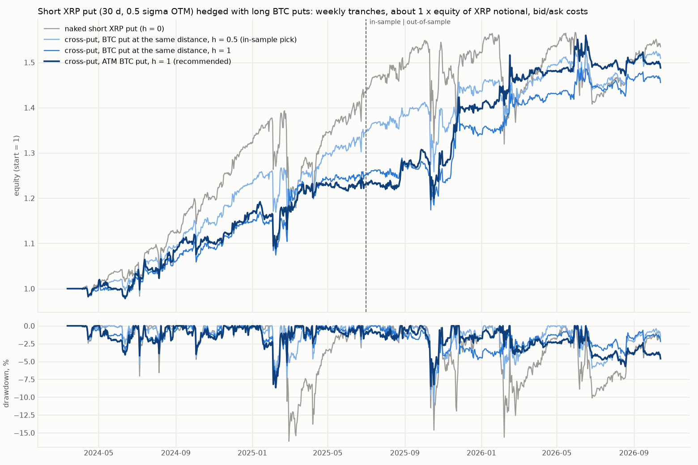

# Phase 5: the cross-put as a portfolio, and attempts to improve it

- **Code:** `scripts/cross_put.py grid | variants | final`.
- **Outputs:** `reports/phase5/` (`grid.csv`, `variants.csv`, `final.csv`, `final_monthly_f1.csv`,
  `final_monthly_f2.csv`, `equity.png`).

## Rules

- **Every Friday at 09:00 UTC** (one hour after the weekly settlement), open one tranche:
  - **short XRP put:** strike K = F × exp(−m × σ_RV × √τ), on the expiry closest to the tenor (σ_RV = XRP's
    trailing 30-day realised vol);
  - **long BTC put** on the same expiry, at distance m_btc in BTC's own realised vol (default m_btc = m). Quantity =
    h × beta × XRP dollar delta / BTC dollar delta, with beta the trailing 30-day hourly beta of XRP on BTC.
- **Tranche size:** XRP notional = f × equity × 7 / tenor, so about f × equity of XRP notional is open at once
  (about 4 tranches at 30 days).
- **Held to expiry,** settled at the index. Daily valuation at the exchange mark price.
- **Costs:**
  - **pessimistic:** bid/ask + 3 bps;
  - **mid:** mid + 10 bps;
  - both capped at 12.5 % of the option price.
- **Margin:** simplified Deribit standard margin for the short XRP puts, max(0.15 − OTM, 0.10) × S + mark per unit;
  the long BTC puts need only their premium. On Deribit the XRP leg is margined in USDC and the BTC leg in BTC, so
  the two need separate collateral.
- **Sample split:**
  - **in-sample:** 2024-03-12 → 2025-06-30;
  - **out-of-sample:** 2025-07-01 → 2026-10-13, restarted at 1;
  - candidates were chosen on in-sample Sharpe at pessimistic costs.

## 1. Grid: tenor × distance × hedge ratio (f = 1, pessimistic costs)

Sharpe, full period (in-sample / out-of-sample):

| Tenor | m | h = 0 (naked) | h = 0.5 | h = 1 | h = 1.5 |
|---|---|---|---|---|---|
| 14 d | 0 (ATM) | 0.63 (1.41 / −0.40) | 0.72 | 0.68 | 0.43 |
| 14 d | 0.5 | 0.68 (1.36 / −0.17) | 0.87 | 0.87 (0.95 / 0.78) | 0.61 |
| 14 d | 1 | 0.80 | 0.99 (1.25 / 0.65) | 0.95 (0.75 / 1.23) | 0.69 |
| 30 d | 0.25 | 0.74 | 0.92 | 0.92 | 0.66 |
| **30 d** | **0.5** | 0.87 (1.46 / 0.29) | **1.10 (1.60 / 0.58)** | **1.12 (1.30 / 0.89)** | 0.80 |
| 30 d | 0.75 | 0.79 | 1.04 (1.46 / 0.63) | 1.04 (1.17 / 0.91) | 0.74 |
| 30 d | 1 | 0.97 | 1.08 | 0.89 | 0.52 |
| 30 d | 1.5 | 0.91 | 1.04 (1.46 / 0.66) | 0.76 | 0.42 |

CAGR scales with distance: at 30 days and h = 1, 15.7 % (m = 0.25), 15.6 % (0.5), 11.9 % (0.75), 7.5 % (1),
4.0 % (1.5).

- **30-day puts beat 14-day puts.** At 14 days the naked put had a negative out-of-sample Sharpe at every distance up to 0.75σ.
- **0.5σ is the sweet spot.** Closer to the money adds return but more risk; further out, the premium shrinks
  faster than the risk.
- **The hedge is needed.** Without it (h = 0), out-of-sample Sharpe falls to 0.3 or below and drawdowns double.
  Over-hedging (h = 1.5) costs too much BTC premium. h = 0.5–1 is best.

## 2. Variants on the best candidates

On 30 d, m = 0.5 (pessimistic costs, f = 1):

| Variant | h = 0.5: CAGR / MDD / Sharpe (IS / OOS) | h = 1: CAGR / MDD / Sharpe (IS / OOS) |
|---|---|---|
| base (BTC put at the same distance) | 17.2 % / −10.9 % / 1.10 (1.60 / 0.58) | 15.6 % / −8.9 % / 1.12 (1.30 / 0.89) |
| **BTC put ATM** | 17.7 % / −11.2 % / 1.09 (1.50 / 0.66) | **16.6 % / −8.7 % / 1.19 (1.23 / 1.14)** |
| BTC put 0.5σ further out | 16.8 % / −10.5 % / 1.09 | 14.7 % / −9.8 % / 0.91 |
| BTC put 1σ further out | 13.0 % / −10.3 % / 0.86 | 8.1 % / −15.6 % / 0.49 |
| gate: XRP put IV > RV − 10 | 10.6 % / −10.9 % / 0.76 | 10.9 % / −8.4 % / 0.89 |
| gate: XRP put IV > RV | 5.5 % / −10.9 % / 0.48 | 6.2 % / −8.4 % / 0.62 |
| gate: XRP put IV > RV + 10 | 2.7 % / −8.2 % / 0.37 | 2.3 % / −6.4 % / 0.38 |

- **The BTC put works best at the money.** A further OTM BTC put is cheaper but hedges less of the common move.
- **Premium gates hurt.** Skipping weeks when the XRP put's IV is not above recent realised vol removes the most
  profitable weeks. High-premium weeks are the turbulent ones; optXRP found the same for its straddle.
- **Size does not change the Sharpe** (1.09–1.18 from f = 0.5 to 3). Return, vol, drawdown and margin scale about
  linearly.

## 3. Final metrics

Recommended: **30-day XRP puts at 0.5σ, hedged with ATM BTC puts, h = 1.** The in-sample ranking alone would have
picked h = 0.5 with the same-distance BTC put; its out-of-sample Sharpe was 0.58, so a realistic expectation sits
between the two.

| Configuration | Size | Costs | CAGR | Vol (daily / weekly) | MDD | Sharpe (daily / weekly) | Worst month | Peak margin | IS / OOS Sharpe | 2024 / 2025 / 2026 |
|---|---|---|---|---|---|---|---|---|---|---|
| naked short XRP put | 1 × | pess | 18.0 % | 21.8 / 23.1 % | −16.2 % | 0.87 / 0.84 | −15.2 % | 0.37 | 1.46 / 0.29 | +32.3 / +15.0 / +0.8 |
| cross-put, h = 0.5 (IS pick) | 1 × | pess | 17.2 % | 15.5 / 14.1 % | −10.9 % | 1.10 / 1.20 | −5.2 % | 0.35 | 1.60 / 0.58 | +23.4 / +16.5 / +5.0 |
| cross-put, h = 1 | 1 × | pess | 15.6 % | 13.9 / 11.8 % | −8.9 % | 1.12 / 1.29 | −3.1 % | 0.36 | 1.30 / 0.89 | +14.9 / +16.8 / +8.5 |
| **cross-put, ATM BTC put, h = 1** | **1 ×** | **pess** | **16.6 %** | 13.7 / 11.8 % | **−8.7 %** | **1.19 / 1.36** | −2.4 % | 0.36 | 1.23 / 1.14 | +16.8 / +19.7 / +6.4 |
| same | 1 × | mid | 17.8 % | 13.7 / 11.8 % | −8.5 % | 1.26 / 1.45 | −2.5 % | 0.36 | 1.35 / 1.17 | +18.3 / +21.1 / +6.5 |
| same | 2 × | pess | 34.4 % | 27.4 / 23.8 % | −16.9 % | 1.22 / 1.37 | −4.8 % | 0.73 | 1.27 / 1.16 | +35.9 / +39.9 / +13.0 |
| same | 2 × | mid | 37.1 % | 27.3 / 23.7 % | −16.7 % | 1.29 / 1.45 | −4.8 % | 0.73 | 1.39 / 1.19 | +39.4 / +43.4 / +13.2 |

2026 runs to 13 October. Monthly returns are in `final_monthly_f1.csv` and `final_monthly_f2.csv`.

## Findings

1. **At 1 × XRP notional the cross-put returned 16.6 %/yr, vol 13.7 %, max drawdown −8.7 %, Sharpe 1.19** at
   bid/ask costs. It was positive in 2024, 2025 and 2026. Out-of-sample Sharpe (1.14) held up for this
   configuration; for the in-sample pick it fell to 0.58.
2. **The BTC hedge buys drawdown control, not return.** Against the naked short XRP put, it gives up 1–2 % of CAGR
   but cuts the max drawdown from −16 % to −9 % and the worst month from −15 % to −2.4 %. It also kept working
   after mid-2025, when the naked put earned almost nothing (out-of-sample CAGR 4 % vs 16 %).
3. **What improved it:**
   - a 30-day tenor instead of 14;
   - 0.5σ strikes;
   - a full beta hedge (h = 1);
   - an ATM BTC put instead of one at the same distance.
   Gates and further-OTM BTC puts made it worse.
4. **Daily marks add noise.** Vol from weekly returns (11.8 %) is lower than from daily (13.7 %), and the weekly
   Sharpe is higher (1.36). The exchange marks on XRP options jump day to day.
5. **Sizing.**
   - At 2 × notional: 34 %/yr with a −17 % drawdown and peak margin about 0.7 × equity.
   - At 3 × the simplified margin exceeds equity (peak 1.2–1.3 ×).
   - The BTC leg needs its own BTC collateral (about the premium paid).

**Caveats.**
- This is the same 2.6-year sample used to find the structure in phase 3. About 200 configurations were tried
  across phases 2–5.
- Between a quarter and a half of the return came from XRP outperforming BTC (phase 3).
- The worst losses come when XRP falls much further than BTC, as in January–February 2025, September–October 2025
  and January 2026.
